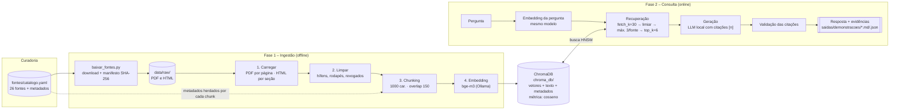
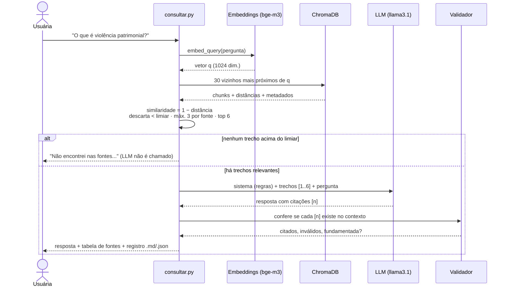

# Arquitetura do sistema

O sistema é um RAG (*Retrieval-Augmented Generation*) local. Ele tem duas fases independentes, que se comunicam só pelo banco vetorial:

1. **Ingestão (offline).** Roda uma vez, ou quando a base muda. Transforma documentos públicos em trechos vetorizados com metadados.
2. **Consulta (online).** Roda a cada pergunta. Recupera os trechos mais relevantes, gera uma resposta citando-os e produz um registro de evidências.

Tudo roda na máquina local: os modelos rodam no Ollama e o banco é o ChromaDB em disco. Nenhum dado sai do computador e não é preciso chave de API.

## Visão geral

## Componentes

| Componente | Arquivo | Responsabilidade |
|---|---|---|
| Catálogo | `fontes/catalogo.yaml`, `rag/catalogo.py` | Define e valida quais documentos compõem a base |
| Coleta | `baixar_fontes.py` | Baixa os documentos e registra a procedência (`data/raw/manifesto.json`) |
| Carregadores | `rag/carregadores.py` | Extrai texto de PDF (por página) e HTML (por seção ou artigo de lei) |
| Limpeza | `rag/limpeza.py` | Normaliza o texto sem reescrever o conteúdo |
| Chunking | `rag/chunking.py` | Divide em trechos e gera IDs determinísticos |
| Embeddings | `rag/embeddings.py` | Converte texto em vetor, com prefixos por modelo e baseline lexical |
| Banco vetorial | `rag/banco_vetorial.py` | Persistência, busca, atualização incremental |
| Recuperação | `rag/recuperacao.py` | Busca, limiar e diversidade de fontes |
| Geração | `rag/geracao.py` | Prompt fundamentado e validação das citações |
| Evidências | `rag/evidencias.py` | Registro rastreável de cada consulta |
| Avaliação | `avaliar.py`, `avaliacao/perguntas.yaml` | Métricas de recuperação com gabarito |

## Sequência de uma consulta

## Decisões de projeto

**Duas fases separadas.** Gerar embeddings é a parte cara, então ela acontece uma vez só. A consulta só gera o embedding da pergunta e faz uma busca no índice.

**Rastreabilidade por construção.** Todo chunk carrega `fonte_id`, título, instituição, ano, URL, página ou seção e o hash do arquivo de origem. A resposta cita números `[n]`, e cada número aponta para um chunk. Assim dá para ir da frase da resposta até a página do PDF original.

**Não confiar no LLM.** Depois de gerar, o código confere as citações. Uma resposta sem citação válida é marcada como não fundamentada, e uma citação para um trecho inexistente é sinalizada. Se a recuperação não traz nada acima do limiar, o LLM nem é chamado, para que ele não "complete" a resposta com conhecimento próprio.

**Diversidade de fontes.** Documentos longos (como o relatório do BC, com mais de 100 páginas) tendem a ocupar todo o topo da busca. O limite de 3 trechos por fonte abre espaço para outras instituições, o que dá respostas mais completas e permite cruzar fontes.

**Configuração versionável.** Todo parâmetro (modelo, tamanho do chunk, k, limiar) fica em `rag/config.py` e pode ser trocado pelo `.env`. A configuração usada é gravada em todo relatório, para que qualquer resultado possa ser reproduzido.

**Uma coleção por modelo de embedding.** O nome da coleção inclui o modelo (`financas_mulheres__ollama__bge_m3`). Por isso dá para comparar modelos sem misturar vetores incompatíveis.

## Tecnologias

| Camada | Escolha | Por quê |
|---|---|---|
| Orquestração | LangChain (core, text-splitters, chroma, ollama) | Interfaces padronizadas; troca de modelo/banco sem reescrever |
| Embeddings | `bge-m3` via Ollama | Multilíngue (PT + EN), contexto de 8192 tokens, roda local |
| Banco vetorial | ChromaDB persistente, índice HNSW, cosseno | Simples, embutido (sem servidor), filtros por metadado |
| LLM | `llama3.1:8b` via Ollama (alternativa: `qwen2.5:7b`) | Local, gratuito, temperatura 0 para respostas estáveis |
| Leitura | `pypdf`, `BeautifulSoup` | Leves e suficientes para PDFs com camada de texto |
