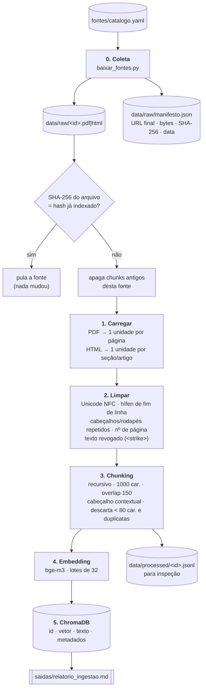

# Pipeline de ingestão de dados

A ingestão transforma os documentos públicos do catálogo em trechos pesquisáveis no banco vetorial. Ela tem uma etapa de coleta e cinco etapas de processamento, executadas por dois scripts.



## Como executar

```bash
python baixar_fontes.py      # etapa 0
python ingerir.py            # etapas 1 a 5 (incremental)
python ingerir.py --reindexar            # recomeça do zero (ex.: mudou CHUNK_SIZE ou o modelo)
python ingerir.py --apenas lei_maria_da_penha   # só uma fonte
```

## Etapa 0: Coleta (`baixar_fontes.py`)

O script lê o catálogo e baixa cada URL para `data/raw/<id>.<formato>`. Se o arquivo já existe, ele é mantido (use `--forcar` para baixar de novo).

Algumas páginas gov.br mostram o PDF dentro de uma página HTML. Nesse caso o script procura o link real do `.pdf` (ou `@@download/file`) e confere os bytes iniciais `%PDF-`, para não salvar HTML com extensão `.pdf`.

O `manifesto.json` registra de onde e quando cada arquivo veio, junto com o SHA-256. Esse é o registro de **procedência** da base.

Se um site bloquear o download automático, baixe o arquivo pelo navegador e salve com o nome indicado. O resto do pipeline funciona igual.

## Etapa 1: Carregar (`rag/carregadores.py`)

Cada formato é convertido em uma lista de **unidades** (texto + localização):

- **PDF:** o `pypdf` extrai o texto página por página e guarda o número da página. É ele que vai aparecer na citação ("p. 37").
- **HTML:** a página é limpa de menus, scripts e rodapés e, quando existe, o `<main>`/`<article>` é isolado. O texto é agrupado por títulos `h1–h4`. Em leis, cada `Art. Nº` vira uma seção, então a citação aponta para o artigo exato.
- **Texto revogado:** nas leis do Planalto, dispositivos revogados aparecem riscados (`<strike>`). Eles são removidos, para que o sistema não cite uma regra que já não vale.

PDFs escaneados (só imagem) não têm texto extraível. A ingestão avisa ("nenhum texto extraível") e essas fontes precisariam de OCR.

## Etapa 2: Limpar (`rag/limpeza.py`)

| Problema | Exemplo | Tratamento |
|---|---|---|
| Hifenização de fim de linha | `finan-\nças` | junta: `finanças` |
| Quebra de linha no meio da frase | `o orçamento\ndoméstico` | vira espaço |
| Cabeçalho/rodapé repetido | `Caderno de Educação Financeira` em todas as páginas | linhas curtas presentes em ≥ 50% das páginas são removidas |
| Número de página solto | `– 12 –` | removido |
| Acentos em formas diferentes | `é` composto vs. decomposto | normalização Unicode NFC |
| Espaços e caracteres de controle | `\u200b`, tabs | removidos |

O princípio é limpar o ruído **sem reescrever** o conteúdo, porque a citação precisa continuar fiel ao original.

## Etapa 3: Chunking (`rag/chunking.py`)

A estratégia completa está em [estrategia_chunking.md](estrategia_chunking.md). Em resumo, o texto é dividido recursivamente por separadores naturais em trechos de cerca de 1000 caracteres, com 150 de sobreposição. Isso é feito dentro de cada página ou seção, e cada trecho recebe um cabeçalho com título, instituição, ano e localização.

Cada chunk recebe um **ID determinístico** (SHA-256 de fonte + hash do documento + índice + texto). Reprocessar o mesmo documento gera os mesmos IDs, então nada é duplicado.

## Etapa 4: Embedding (`rag/embeddings.py`)

Cada chunk é convertido em um vetor de 1024 dimensões pelo `bge-m3`. A estratégia está em [estrategia_embeddings.md](estrategia_embeddings.md). O envio ao Ollama é feito em lotes de 32, para não estourar memória nem tempo limite.

## Etapa 5: Armazenamento (`rag/banco_vetorial.py`)

O Chroma grava, para cada chunk, o ID, o vetor, o texto (com o cabeçalho) e estes metadados:

| Metadado | Uso |
|---|---|
| `fonte_id`, `titulo`, `instituicao`, `ano`, `url` | citação e filtro por fonte |
| `pagina` (PDF) / `secao` (HTML) | localizar o trecho no original |
| `eixo`, `idioma`, `foco_mulheres` | filtros e análise da base |
| `doc_hash` | atualização incremental |
| `chunk_indice`, `n_caracteres` | depuração e estatísticas |

A coleção usa **distância de cosseno** (`hnsw:space = cosine`) e o índice HNSW, que faz a busca aproximada de vizinhos.

## Atualização incremental (idempotência)

| Situação | O que acontece |
|---|---|
| Arquivo igual ao já indexado (mesmo SHA-256) | fonte pulada |
| Arquivo alterado | chunks antigos apagados, fonte reprocessada |
| Fonte nova no catálogo | indexada |
| Fonte removida do catálogo | chunks apagados do banco |
| Mudou modelo de embedding | vai para outra coleção automaticamente |
| Mudou `CHUNK_SIZE`/`CHUNK_OVERLAP` | rode `--reindexar` (o hash do arquivo não mudou) |

## Saídas para conferência

- `saidas/relatorio_ingestao.md`: tabela por fonte, com unidades, chunks, tamanho médio e status. **É o artefato que comprova o mínimo de 20 documentos indexados.**
- `data/processed/<id>.jsonl`: todos os chunks de cada fonte. Abra para ver exatamente o que o modelo "enxerga" (ótimo para achar problemas de extração).
